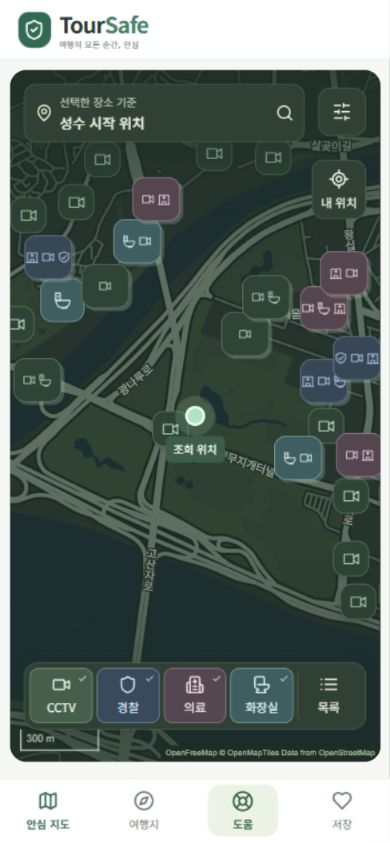
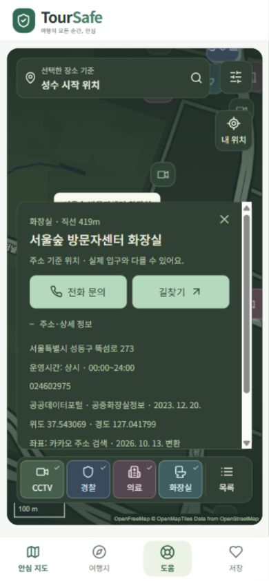
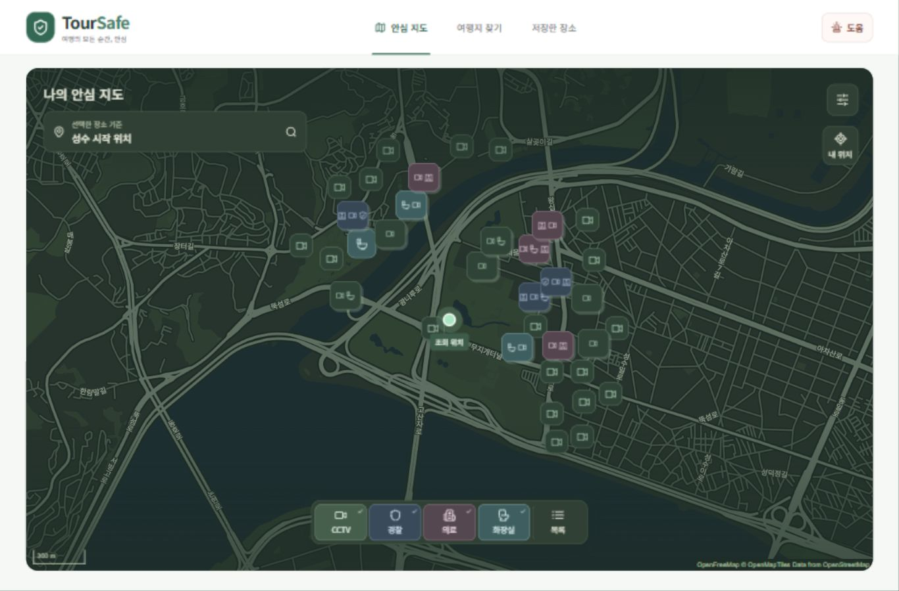

# 성동구 화장실 지도 연결

## 결과

- 원본: 사용자가 제공한 공중화장실정보.csv를 적재한 `2026-10-13T08-14-06-364Z` 버전의 성동구 주소 목록 210곳.
- 원주소 192개, 괄호·쉼표 뒤 건물/층 부연을 제외한 검색 주소 186개. 기존 카카오 REST API 키로 주소별 1회 조회했다.
- 189곳의 주소 좌표를 연결했다. 일치 여부를 확인하지 못한 21곳은 거리·핀을 만들어내지 않고 주소 목록에 유지한다.
- 성수 시작 위치(37.5445, 127.0374)에서 직선 3km 내 변환 자료 181곳. 지도와 목록에는 거리순으로 가까운 최대 20곳을 제공한다.
- 하단 CCTV / 경찰 / 의료 / 화장실 / 목록. 기존 세 가지 기본 표시는 유지한다. 화장실은 첫 방문 시 끈 상태이고 선택은 기존 localStorage 설정에 저장한다. 현재 검증 브라우저에서는 켜 두었다.
- 화장실을 선택하면 주소 기준 위치 안내, 직선거리, 전화·길찾기, 펼치는 상세정보에 개방시간·위도·경도·자료일자·좌표 변환일자를 표시한다.
- 같은 주소의 여러 화장실은 같은 좌표로 묶이며 각각 선택 가능하다. 층이나 실제 입구는 확인되지 않았다.

## 변환과 보존

`scripts/geocode-toilets.ts`는 웹 요청과 분리된 유지보수 명령이다. 전국 자동 변환을 하지 않으며 성동구 최대 300개 레코드로 범위를 제한한다.

```powershell
# 예상 조회량만 확인
npm run geocode:toilets
# 실제 변환. 이 환경의 PowerShell npm 래퍼가 --run을 전달하지 않아 직접 실행한다.
node --import tsx scripts/geocode-toilets.ts --run
```

주소 검색은 `analyze_type=exact`를 사용한다. 결과가 단 하나이고 ROAD_ADDR/REGION_ADDR이며 서울 성동구이고, 반환 주소가 정규화한 입력 주소와 일치하고 유효한 국내 좌표일 때만 채택한다. 서울특별시/서울 표기는 동일하게 비교한다. 도로·동의 대표점, 유사 주소, 다른 번지, 복수 후보는 채택하지 않는다.

결과 파일은 Git 제외 디렉터리의 `backend/data/public-facilities/geocoded-toilets-seongdong.json`이다. API 키는 포함되지 않는다. 원 CSV와 원 적재 자료는 수정하지 않았다. 시설 ID·원주소·적재 버전이 일치할 때만 기존 데이터에 합친다. 파일 누락·손상·버전 불일치 시 주소 목록으로 돌아가며 CCTV 등 기존 시설 조회는 유지한다.

진행 중 20개 주소마다 임시 파일을 쓴 뒤 교체한다. 통신 오류 시 진행분을 보존하고 중단하며 자동 재시도하지 않는다. 완료 후 재실행에서 API 호출 0회, 같은 189/21 결과를 확인했다. 새 자료를 적재하면 새 버전에서 다시 변환해야 한다. 배포 시 해당 적재 데이터와 변환 파일도 서버로 함께 옮겨야 한다.

시설 원자료 기준일(현재 성동구 자료는 2023-12-20)과 좌표 변환일(2026-10-13)은 별도로 표시한다. 주소 변환 성공이 시설의 현재 개방, 운영 지속 또는 실제 출입구 위치를 확인한 것은 아니다.

## 검증

- 전체 테스트 123개 통과. 최종 변경 후 화장실 테스트 4개 재확인.
- 최종 TypeScript + Vite 빌드 통과. 기존 MapLibre 대형 청크 경고는 남아 있다.
- 정확한 주소 매칭, 복수·빈·다른 구·다른 번지·잘못된 좌표 거절, 적재 버전/주소 변경, 파일 손상, 반경 밖 제외, 인접 행정구역에서도 성동구 핀 제공, 주소 목록 중복 제외, CCTV 유지 검증.
- 로컬 실제 API 응답: TOILET 총 181, 반환 20, 위치 미확인 21, 공공시설 상태 OK, 좌표 유효 및 거리순 정렬 확인.
- 브라우저 320×740 / 390×844 / 1366×900. 가로 넘침 없음. 320px 하단 버튼 약 49×56 CSS px.
- 화장실 끄기 시 해당 핀·선택 카드 제거, 기존 3개 표시 유지. 목록에서 선택하면 화장실 표시 자동 켜짐. 새로고침 후 선택 유지.
- 주소 목록 펼침, 겹친 핀 목록에서 다른 화장실 선택, 상세정보 좌표·개방시간 확인. 전화와 외부 길찾기는 실행하지 않았다.
- 브라우저 오류 로그 조회 결과 없음.

## 화면





## 공식 자료

- [전국공중화장실표준데이터](https://www.data.go.kr/data/15012892/standard.do): 2025년 2월 좌표 제공 중단 안내.
- [카카오 주소로 좌표 변환](https://developers.kakao.com/docs/ko/local/dev-guide#address-coord): REST API 주소 검색, 결과 유형 및 x/y 좌표 규격.
